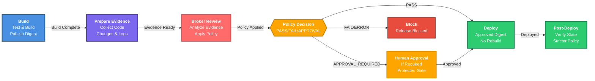
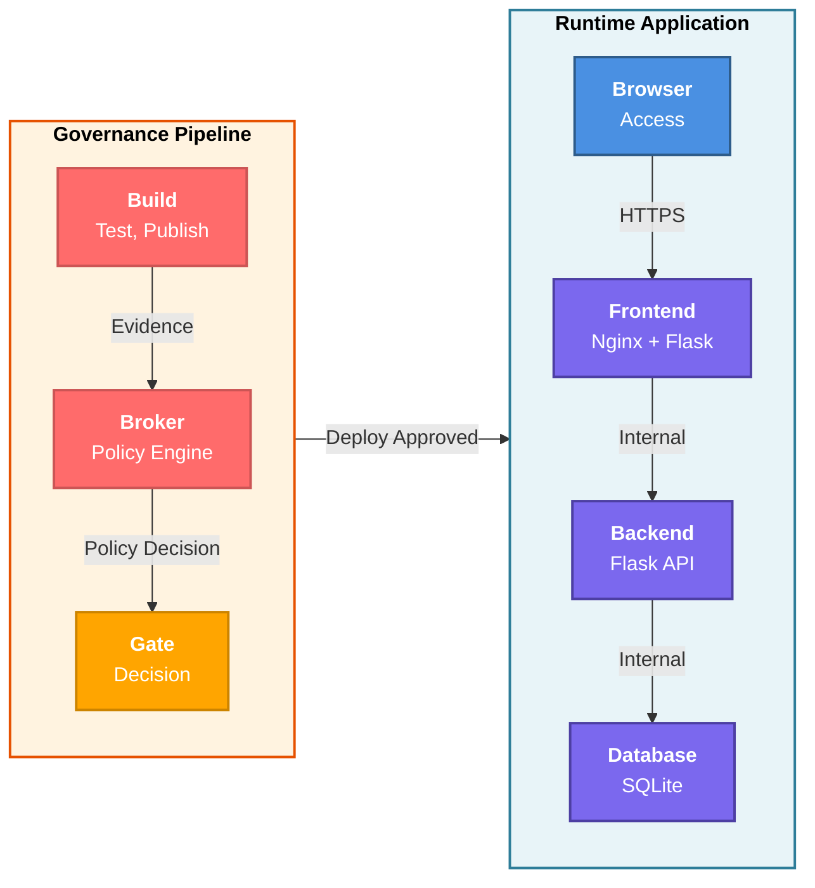

# DRA 2.0 Release Governance Proof of Concept

Demonstrates release governance with policy-driven approval gates and evidence-based deployment decisions.

## The Proof of Concept

**Goal:** Prove that a broker-based policy engine can control application deployments through evidence review and human approval gates.

**What This Does:**
- Collects evidence from code builds (changes, dependencies, test results)
- Submits evidence to a policy engine (Broker) for review
- Enforces policy decisions (PASS/FAIL/APPROVAL_REQUIRED/ERROR)
- Routes approval decisions to human reviewers when needed
- Deploys only approved, reviewed code digests
- Verifies post-deployment state

**Not What This Is:**
- Not about features or user experience
- Not a production application
- Not complex business logic
- The application itself is minimal; the governance pipeline is the focus

## How It Works



## Architecture



**Key Design:** Only frontend is public. Backend and database are internal. Broker is invoked during deployment decisions, not runtime.

## The Application

The app is intentionally minimal — a simple task tracker to have *something to deploy*.

**Functionality:**
- Login with demo credentials
- Create, read, delete tasks
- Simple HTML UI (no framework, no fancy design)
- SQLite storage

**Purpose:** Proves the governance pipeline works with a real (if simple) application.

## Quick Start

```sh
# Configure credentials
cp .env.example .env
# Edit .env: set INTERNAL_API_TOKEN, DEMO_USERNAME, DEMO_PASSWORD

# Run locally
docker compose up --build

# Access the application
open http://localhost:8080
```

## What Matters Here

| Concern | What We're Proving |
|---------|-------------------|
| **Evidence Collection** | Can we extract code and build data? |
| **Policy Enforcement** | Does the Broker correctly apply policy? |
| **Approval Gates** | Can humans block or approve? |
| **Immutable Deployment** | Does reviewed code actually deploy unchanged? |
| **Post-Deploy Verification** | Can we verify deployment and enforce stricter policy? |

**NOT the focus:**
- Beautiful UI
- Complex features
- Enterprise scalability
- User experience

## Documentation

| Document | Purpose |
|----------|---------|
| **[Architecture](docs/architecture.md)** | Release governance flow, broker integration, deployment stages |
| **[Broker Reference](docs/broker.md)** | Policy outcomes, evidence validation, result format |
| **[Operations](docs/operations.md)** | Security, deployment, troubleshooting |
| **[Getting Started](docs/USAGE.MD)** | Local setup, Docker Compose, scripts |

See **[Documentation Index](docs/index.MD)** for complete navigation.

## Key Design Decisions

### By Design
- **Application is minimal** — Just enough to deploy and verify
- **Broker is external** — Separate service, not included in code
- **Evidence is collected** — Code, logs, build artifacts
- **Policy gates are enforced** — Humans approve when policy requires it
- **Deployment is immutable** — No rebuilds after review
- **Post-deploy is stricter** — Tighter policy for runtime safety

### Scope Limits
- Simple app (task tracker)
- Demo credentials (no OAuth/LDAP)
- No auto-rollback (deliberate limitation)
- No persistent storage in Azure (POC design)

## Development Phases

| Phase | Focus | Duration |
|-------|-------|----------|
| 1 | Minimal app (database, API, basic UI) | Week 1 |
| 2 | Docker & docker-compose | Week 1 |
| 3 | CI/CD pipeline & evidence collection | Week 2 |
| 4 | Broker integration & approval gates | Week 2 |
| 5 | Testing, quality gates, post-deploy | Week 1 |

## Success Criteria

✓ Application runs (docker-compose up works)  
✓ CI/CD pipeline executes (test → build → publish)  
✓ Evidence is collected and formatted correctly  
✓ Broker can be invoked (mocked or real)  
✓ Policy decisions are enforced (PASS/FAIL/APPROVAL)  
✓ Approval gates work (human can approve/reject)  
✓ Deployment uses reviewed digests (no rebuild)  
✓ Post-deployment verification runs  

## License

**Proprietary.** Public visibility grants no reuse or deployment rights.

Execution, testing, and deployment require prior written permission.  
See [LICENSE](LICENSE) for complete terms.

---

<p align="center">
	<sub><span style="color:#666">DRA 2.0 POC · Release Governance Demonstration · Dr. Georges Bou Ghantous © 2026</span></sub>
</p>
