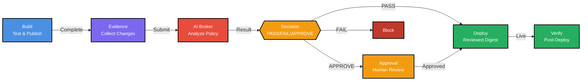
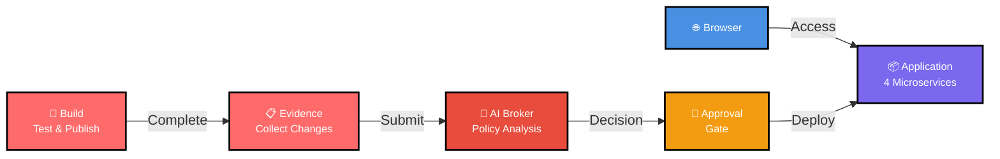

# DRA 2.0 — Release Governance with AI Policy Engine

Demonstrates policy-driven release gates using AI evidence analysis and human approval.

**Status:** Proprietary POC. Prior written permission required.

## Overview

**What It Proves:**
- AI policy engine (Broker) reviews evidence from code builds
- Evidence-based decisions block, require approval, or pass releases
- Human reviewers approve when policy requires it
- Deployed code matches exactly what was reviewed (by digest)
- Post-deployment verification enforces stricter policy

**Key Principles:**
- Immutable deployments by SHA256 digest
- Evidence-driven decisions (no guessing)
- Fail closed (errors block, never authorize)
- Human approval gates for approval-required findings

## AI Policy Engine Workflow



## System Architecture



## The Application

Task tracker: minimal app to verify governance pipeline works with real code.

- **Frontend:** Nginx (login, dashboard)
- **Backend:** Flask REST API (authentication, task CRUD)
- **Database:** CRUD API over SQLite
- **UI:** Plain HTML, no framework

**Run Locally:**
```sh
cp .env.example .env
docker compose up --build
open http://localhost:8080
```

## Key Design Decisions

| Aspect | Decision | Reason |
|--------|----------|--------|
| **App** | Minimal (tasks only) | Focus on governance, not features |
| **Deployment** | By digest (SHA256) | Ensures exact reviewed code runs |
| **Policy** | AI-based | Demonstrates automated governance |
| **Human Gate** | For approval findings | Humans control medium-severity releases |
| **Post-Deploy** | Stricter policy | Enforce governance at runtime |
| **Scope** | POC only | Not production-ready; demonstrates concept |

## Documentation

Complete guides and references for setup, deployment, and operations.

- **[Quick Start](docs/USAGE.MD)** — Local setup, testing, CI/CD workflow
- **[Architecture](docs/architecture.md)** — System design, broker flow, policy outcomes
- **[Broker Spec](docs/broker.md)** — Policy evaluation, evidence format, results
- **[Operations](docs/operations.md)** — Setup, deployment, troubleshooting
- **[Index](docs/index.MD)** — Complete documentation navigation

## License

**Proprietary.** Prior written permission required. See [LICENSE](LICENSE).
