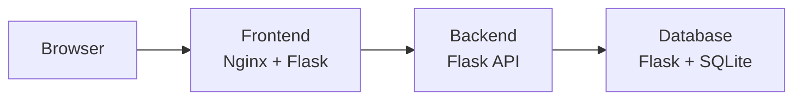

# DRA 2.0 PC Demo App with AI-Broker Assistance

A containerized task-management demo for creating, editing, filtering, and tracking work. It also demonstrates integration with DRA 2.0 AI-Broker (c), a separate evidence scanner for authorized CI/CD workflows. The broker analyzes explicitly selected pre- and post-deployment evidence with Gemini or Groq and maps findings to deterministic policy outcomes; it does not build or deploy software.

## What’s inside

| Service | Responsibility |
| --- | --- |
| Frontend | Authenticated task UI, served by Nginx and Flask; HTMX powers task updates. |
| Backend | Internal REST API and task validation. |
| Database | Internal CRUD API with SQLite storage. |



Only the frontend is exposed publicly. The private AI-Broker source is maintained separately; pinned broker images run in GitHub Actions for release review and post-deployment verification.

## Project structure

```text
.
├── .github/workflows/
│   ├── ci-cd.yml
│   └── post-deployment.yml
├── backend/
│   ├── app.py               # Internal task API
│   ├── tasks.py             # Validation rules
│   ├── Dockerfile
│   ├── requirements.txt
│   └── tests/test_tasks.py
├── database/
│   ├── app.py               # Internal CRUD API
│   ├── crud.py
│   ├── schema.sql
│   ├── Dockerfile
│   ├── requirements.txt
│   └── tests/test_crud.py
├── frontend/
│   ├── app.py               # Flask UI and backend client
│   ├── nginx.conf
│   ├── Dockerfile
│   ├── requirements.txt
│   ├── static/
│   │   ├── style.css
│   │   └── theme.js
│   ├── templates/           # Jinja pages and task fragments
│   │   ├── base.html
│   │   ├── index.html
│   │   └── tasks.html
│   └── tests/test_pages.py
├── scripts/
│   ├── setup.sh
│   ├── env-setup.sh
│   ├── validate.sh
│   ├── build.sh
│   ├── review.sh
│   ├── deploy.sh
│   ├── post-deploy.sh
│   └── cleanup.sh
├── .env.example
├── .gitignore
├── docker-compose.yml
├── LICENSE
└── README.md
```

## Run locally

**Requirements:** Docker Engine and Docker Compose.

```sh
cp .env.example .env
```

Edit `.env` and replace the placeholders for `INTERNAL_API_TOKEN`, `DEMO_USERNAME`, and `DEMO_PASSWORD` with strong, unique values. Do not commit `.env`.

```sh
docker compose up --build
```

Open [http://localhost:8080](http://localhost:8080) and sign in with your demo credentials. Check service health with:

```sh
curl http://localhost:8080/health
```

Compose persists local SQLite data in a named volume. `docker compose down -v` deletes it. The UI loads HTMX 2.0.4 from jsDelivr, so dynamic task actions require browser internet access.

## Test and build

**Requirements:** Python 3.12 and Docker.

```sh
python -m pip install \
  -r frontend/requirements.txt \
  -r backend/requirements.txt \
  -r database/requirements.txt
python -m pytest frontend/tests backend/tests database/tests -q
bash -n scripts/*.sh
bash scripts/build.sh
```

## Azure CI/CD

The workflows test changes, publish immutable application image digests to Azure Container Registry, and run a separately published, pinned private broker image. Deployment uses the reviewed digests without rebuilding. `FAIL` and `ERROR` block release; `APPROVAL_REQUIRED` needs the protected `dra-approval` environment and `APPROVAL_GATE_ENABLED=true`.

> **Storage:** Azure does not configure persistent SQLite storage, so data may be lost when the database container restarts or is replaced. This proof of concept is not a production database deployment.

<details>
<summary>Configuration and operational notes</summary>

1. Configure GitHub Actions OIDC federation and Azure permissions for ACR push and Container Apps deployment. Initial deployment may also need permission to assign `AcrPull` roles.
2. Run `scripts/setup.sh` with the required Azure settings to create the resource group, registry, and Container Apps environment. It does not configure OIDC.
3. Publish the private broker image. Set `BROKER_IMAGE_DIGEST` to its immutable `ghcr.io/OWNER/IMAGE@sha256:...` reference and grant `GHCR_READ_TOKEN` package access.
4. Configure the GitHub repository variables and secrets listed below. Configure required reviewers on `dra-approval` before enabling approval-based releases.

**Repository variables:** `AZURE_CLIENT_ID`, `AZURE_TENANT_ID`, `AZURE_SUBSCRIPTION_ID`, `AZURE_RESOURCE_GROUP`, `AZURE_LOCATION`, `AZURE_ACR_NAME`, `AZURE_CONTAINERAPPS_ENV`, `AZURE_FRONTEND_APP`, `AZURE_BACKEND_APP`, `AZURE_DATABASE_APP`, `GHCR_USER`, `BROKER_IMAGE_DIGEST`, `AI_PROVIDER`, `GEMINI_MODEL`, `GROQ_MODEL`. `AI_PROVIDER` must be `gemini` or `groq`; `APPROVAL_GATE_ENABLED` is needed for approval-based releases.

**Repository secrets:** `GHCR_READ_TOKEN`, `GEMINI_API_KEY`, `GROQ_API_KEY`, `INTERNAL_API_TOKEN`, `DEMO_USERNAME`, `DEMO_PASSWORD`. Set the API key for the selected provider. Review evidence is sent to an external model provider; never include secrets in code changes or evidence.

After deployment, a separate workflow checks Azure revisions and health, then invokes the pinned broker. Evidence is retained for 30 days. Verification does not roll back deployments or provide ongoing monitoring.

</details>

## License

This repository is publicly visible, but its [proprietary license](LICENSE) grants no reuse permission. Third-party packages remain subject to their own licenses.

<p align="center">
	<sub><sup><span style="color:#9aa0a6">👨‍🎓 Author: Dr. Georges Bou Ghantous © 2026</span></sup></sub>
</p>
