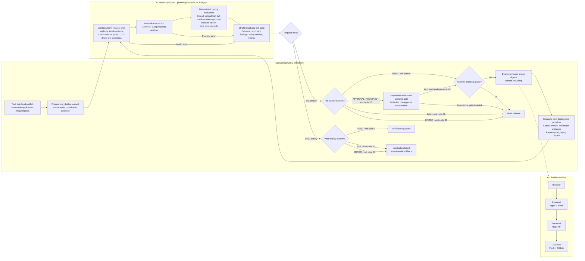

# DRA 2.0 POC Demo App

- Containerized task-management demo with pre- and post-deployment AI-Broker evidence review.
- Proprietary proof of concept, not a production-ready product.
- Not open to external contributions; see the [contribution policy](docs/CONTRIBUTING.md).

## What’s inside

| Service | Responsibility |
| --- | --- |
| Frontend | Authenticated task UI, served by Nginx and Flask; HTMX powers task updates. |
| Backend | Internal REST API and task validation. |
| Database | Internal CRUD API with SQLite storage. |

- Only the frontend is publicly exposed; backend and database APIs are internal.

## Application and Release Flow

## Broker Review

- AI-Broker is private, maintained separately, and not included in this repository.
- It reviews selected evidence using Gemini or Groq and maps findings to policy outcomes.
- Workflows enforce release gates and retain results; the broker does not build, deploy, or modify code.
- Post-deployment review is a separate invocation, not continuous monitoring or automatic rollback.
- Findings are model-generated recommendations, not verified vulnerabilities.

### Outcomes

- Numbers are broker process exit codes, not severity scores.
- `PASS` (`0`): broker check passes; all other required checks must also pass.
- `APPROVAL_REQUIRED` (`20`): pre-deployment review requires an enabled, protected approval gate and human approval.
- `FAIL` (`10`): findings trigger a policy failure, including approval-level findings in post-deployment mode.
- `ERROR` (`30`): the scan could not complete, for example due to invalid evidence or a provider error.
- `FAIL` and `ERROR` block release or fail post-deployment verification; errors never authorize deployment.

## Operation and Limits

- Use the [usage guide](docs/USAGE.MD) for local execution and Azure script entry points.
- Manually dispatch the release workflow; automatic runs on pushes to `main` are disabled.
- Deploy reviewed, immutable image digests without rebuilding; the deployment script alone does not enforce review gates.
- Pin the private broker image to an approved GHCR digest.
- Pre-filter sensitive evidence before external inference; redaction is best-effort.
- Keep credentials in protected CI secrets and never expose them to untrusted pull requests.
- Azure SQLite storage is not configured for persistence; container restarts or replacement may lose data.

## Documentation

- [Documentation index](docs/index.MD)
- [Usage and script reference](docs/USAGE.MD)
- [Contribution policy](docs/CONTRIBUTING.md)
- [Glossary](docs/glossary.md)

## License

- Public visibility grants no reuse permission; see the [proprietary license](LICENSE).
- Execution, testing, and deployment require prior written permission.
- Third-party packages remain subject to their own licenses.

---

	👨‍🎓 Author: Dr. Georges Bou Ghantous © 2026

