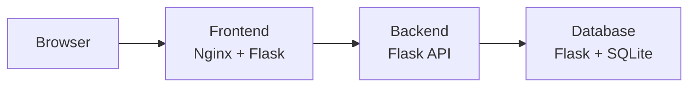

# DRA 2.0 POC Demo App

A containerized task-management demo with DRA 2.0 AI-Broker integration for pre- and post-deployment evidence review.

## What’s inside

| Service | Responsibility |
| --- | --- |
| Frontend | Authenticated task UI, served by Nginx and Flask; HTMX powers task updates. |
| Backend | Internal REST API and task validation. |
| Database | Internal CRUD API with SQLite storage. |

Only the frontend is exposed publicly. The separately maintained AI-Broker reviews selected evidence using Gemini or Groq; it does not build or deploy software.

## Documentation

- [Documentation index](docs/index.MD)
- [Usage and setup](docs/USAGE.MD)
- [Contributions](docs/CONTRIBUTING.md)
- [Glossary](docs/glossary.md)

This is a proof of concept, not a production deployment. See the usage guide for storage and evidence-privacy limitations.

## License

This repository is publicly visible, but its [proprietary license](LICENSE) grants no reuse permission. Third-party packages remain subject to their own licenses.

	👨‍🎓 Author: Dr. Georges Bou Ghantous © 2026

