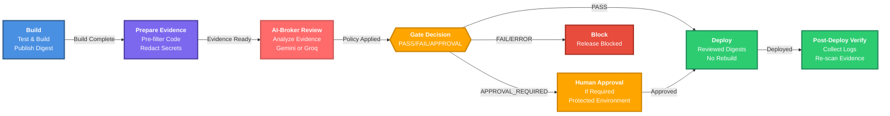
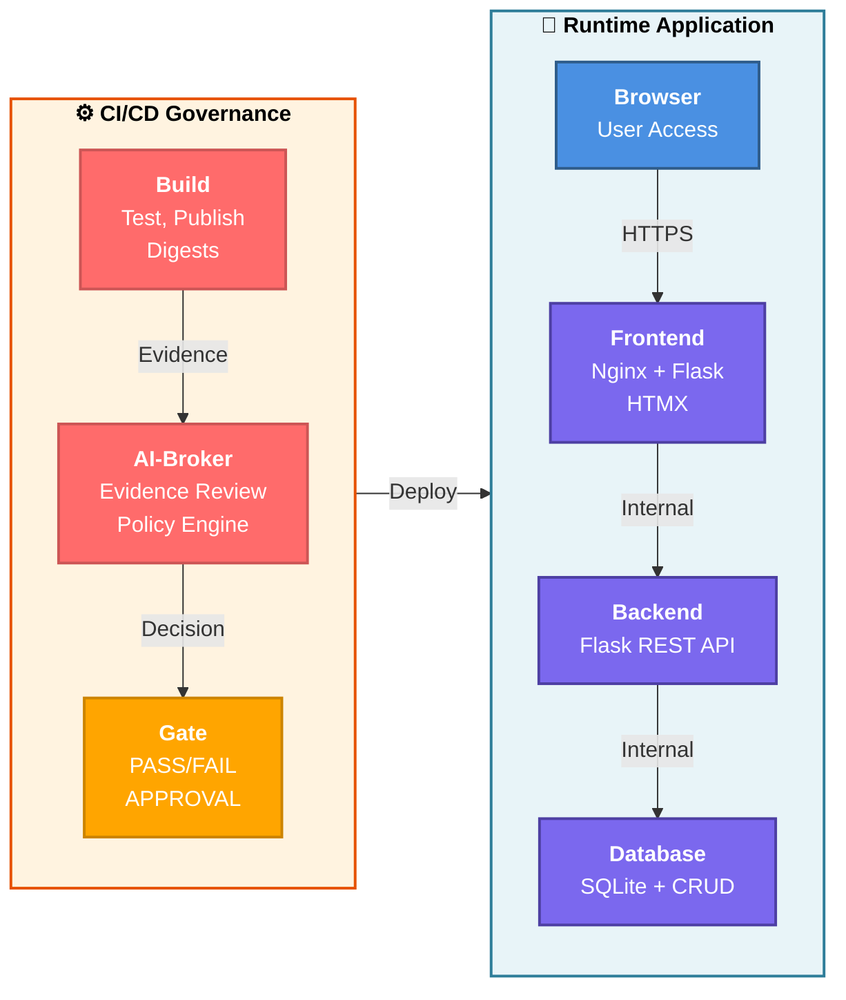

# DRA 2.0 POC Demo Application

An enterprise-grade task management system demonstrating AI-driven release governance with automated evidence review and human-controlled approval gates.

## The POC Project

- **Task Management Application** — Containerized, multi-tier system (Frontend, Backend, Database) for authenticated task operations
- **Release Governance Platform** — Orchestrates code review, evidence analysis, and deployment gates with deterministic policy enforcement
- **Proof of Concept** — Not production-ready; demonstrates integration patterns between applications and AI-driven policy engines

## What Is AI-Broker

An external, independently maintained policy engine that:
- Analyzes selected code, build, and deployment evidence using Gemini or Groq
- Returns deterministic outcomes: PASS, FAIL, APPROVAL_REQUIRED, or ERROR
- Enforces configurable policy (critical/high findings block release, medium findings gate approval)
- Handles pre-deployment review (can require approval) and post-deployment verification (stricter policy)

## How It Works



## Architecture



**Key Design:** Only frontend is public (HTTPS). Backend and database are internal. AI-Broker is external, invoked during CI/CD only.

## Quick Start

```sh
# Configure credentials
cp .env.example .env
# Edit .env: set INTERNAL_API_TOKEN, DEMO_USERNAME, DEMO_PASSWORD

# Run locally
docker compose up --build

# Access the application
open http://localhost:8080
```

## Project Structure

```
frontend/           # Nginx reverse proxy + Flask UI + HTMX
backend/            # Flask REST API + task validation
database/           # CRUD API + SQLite persistence
scripts/            # Automation: build, review, deploy, verify
.github/workflows/  # Release and post-deployment gates
docs/               # Complete documentation
```

## Documentation

| Document | Purpose |
|----------|---------|
| **[Architecture](docs/architecture.md)** | Complete CI/CD flow, broker integration, deployment stages |
| **[AI-Broker](docs/broker.md)** | Review modes, exit codes, policy evaluation, findings format |
| **[Operations](docs/operations.md)** | Security, Azure deployment, limits, troubleshooting |
| **[Getting Started](docs/USAGE.MD)** | Local setup, Docker Compose, Azure scripts, validation |
| **[Glossary](docs/glossary.md)** | Terminology and definitions |

See **[Documentation Index](docs/index.MD)** for complete navigation.

## Security & Compliance

- **Immutable Digests:** Reviewed images deployed by digest; no rebuilds
- **Evidence Redaction:** Pre-filter secrets before broker analysis (best-effort redaction)
- **Approval Gates:** Configurable human approval via protected GitHub environments
- **Audit Trail:** All results retained for 30 days
- **Credential Storage:** All secrets in protected CI/CD variables; never exposed to untrusted PRs

## Important Limitations

- **Not for Production:** POC only; not hardened or tested for production use
- **No Automatic Rollback:** Post-deployment verification can fail but does not trigger rollback
- **Data Persistence:** Azure deployment does not configure persistent storage; database may reset on restart
- **Broker Scope:** Broker is external service; not built, maintained, or included in this repository
- **Model Recommendations:** Broker findings are model-generated; not verified vulnerabilities

## License & Access

**Proprietary.** Public visibility grants no reuse, modification, testing, or deployment rights.

Execution, testing, and deployment require prior written permission from the copyright holder.  
See [LICENSE](LICENSE) for complete terms.

---

<p align="center">
	<sub><span style="color:#666">DRA 2.0 POC · Release Governance Demo · Dr. Georges Bou Ghantous © 2026</span></sub>
</p>
