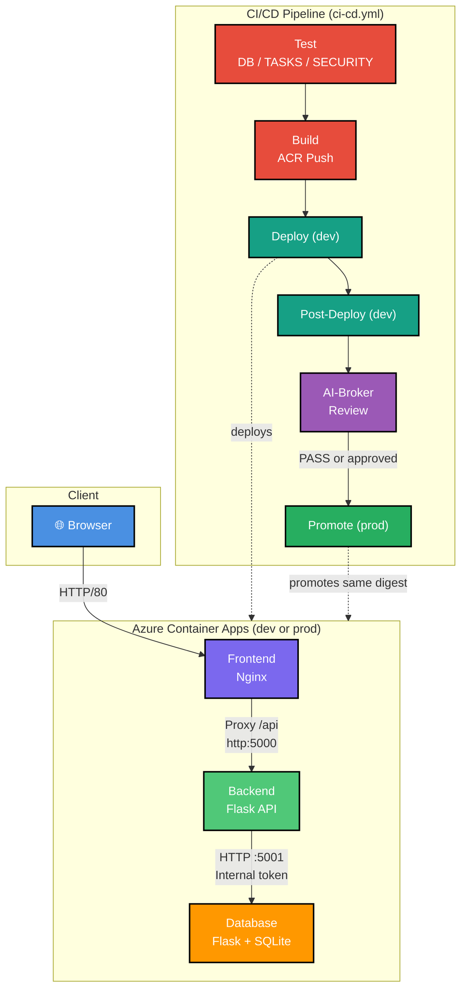
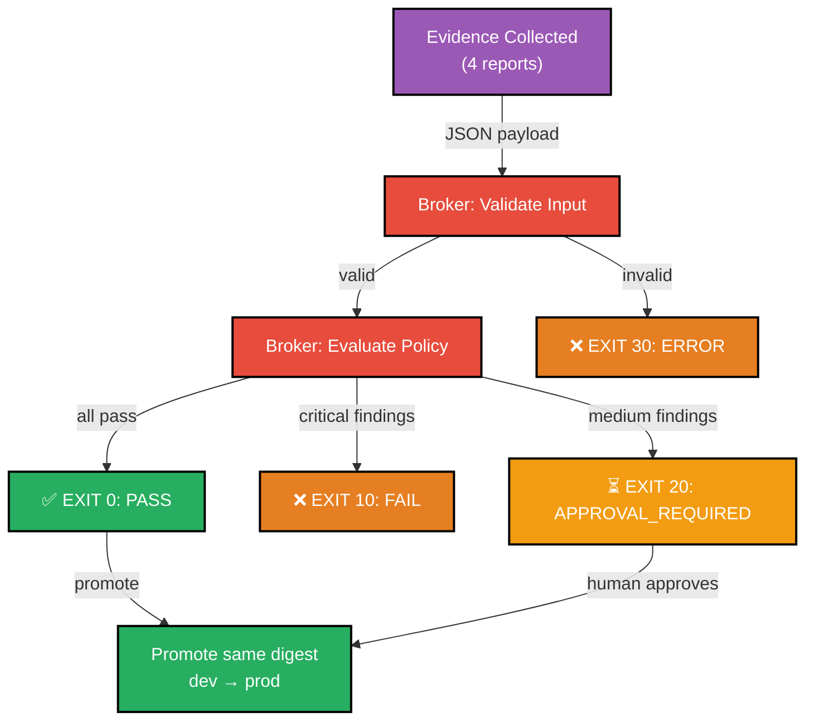

# Architecture: Release Governance Pipeline

This document describes the governance pipeline architecture and how the Broker controls release decisions.

## Overview

The POC demonstrates a release governance system where a Broker (policy engine) controls promotion to production by:
1. **Testing** application functionality and security (DB, TASKS, SECURITY suites)
2. **Building** container images and publishing them to ACR by immutable digest
3. **Deploying** to a dev-stage Azure Container Apps environment
4. **Collecting evidence** from the test, build, deploy, and post-deploy stages
5. **Evaluating policies** against that evidence (AI-Broker)
6. **Making deterministic decisions** (PASS, FAIL, APPROVAL_REQUIRED, ERROR)
7. **Promoting** the same approved digest to production on PASS (or an approved APPROVAL_REQUIRED)

## System Architecture



**Three-Container Application (deployed twice: dev stage, then promoted to prod stage):**
1. **Frontend** (Nginx): Reverse proxy, serves static HTML/CSS/JS, routes `/api/*` to backend
2. **Backend** (Flask): REST API with authentication, proxies task operations to database
3. **Database** (Flask + SQLite): CRUD API that manages task storage

**Networking:** Docker bridge network enables cross-container communication via service DNS. Ports: frontend 8080→80, backend 5000, database 5001. Health checks on `/health` endpoint.

**Azure dev/prod staging:** One resource group, one Container Apps environment, one ACR, and one Log Analytics workspace are shared; each service gets a `<base>-dev` and `<base>-prod` Container App pair (6 apps total). The Broker's decision controls whether a build is ever promoted from dev to prod — see [Release Governance Flow](#release-governance-flow) below.

## Release Governance Flow

```mermaid
graph LR
    A["🧪 Test<br/>DB/TASKS/SECURITY"] --> B["🔨 Build & Publish"]
    B --> C["🚀 Deploy (dev)"]
    C --> D["🩺 Post-Deploy (dev)"]
    D -->|4 reports| E["🔍 AI-Broker Review"]
    E -->|decision| F{"Exit Code"}
    F -->|0: PASS| G["✅ Promote to Prod"]
    F -->|10/30: FAIL/ERROR| H["❌ Reject"]
    F -->|20: APPROVAL_REQUIRED| I["⏳ Human Approval Gate"]
    I -->|approved| G
    I -->|rejected| H
    
    style A fill:#E74C3C,stroke:#000,stroke-width:2px,color:#fff
    style B fill:#E74C3C,stroke:#000,stroke-width:2px,color:#fff
    style C fill:#16A085,stroke:#000,stroke-width:2px,color:#fff
    style D fill:#16A085,stroke:#000,stroke-width:2px,color:#fff
    style E fill:#9B59B6,stroke:#000,stroke-width:2px,color:#fff
    style F fill:#34495E,stroke:#000,stroke-width:2px,color:#fff
    style G fill:#27AE60,stroke:#000,stroke-width:2px,color:#fff
    style H fill:#E67E22,stroke:#000,stroke-width:2px,color:#fff
    style I fill:#F39C12,stroke:#000,stroke-width:2px,color:#fff
```



## Exit Codes & Policy Outcomes

The Broker returns deterministic exit codes that drive the promotion decision:

| Exit Code | Outcome | Action | Notes |
|-----------|---------|--------|-------|
| 0 | PASS | Promote same digest to prod | All policies satisfied |
| 10 | FAIL | Reject; prod untouched | Policy violation; no approval gate |
| 20 | APPROVAL_REQUIRED | Route to human gate | Medium/minor findings; approval can override |
| 30 | ERROR | Reject; prod untouched | Validation failure or provider error |

## Evidence Collection

Evidence is four Markdown reports produced by the pipeline and written to `temp/reports/` (uploaded as GitHub Actions artifacts, then handed to the Broker as its evidence bundle):

| Report | Script | Contents |
|--------|--------|----------|
| `temp/reports/test_report.md` | [scripts/post-test.sh](../scripts/post-test.sh) | Status + pass/fail/error/skip counts per suite: DB, TASKS, SECURITY |
| `temp/reports/build_report.md` | [scripts/build.sh](../scripts/build.sh) | Per-service image digest after build & ACR push |
| `temp/reports/deployment_report.md` | [scripts/deploy.sh](../scripts/deploy.sh) `STAGE=dev` | Per-service app name, image digest, FQDN for the dev deployment |
| `temp/reports/results.md` | [scripts/post-deploy.sh](../scripts/post-deploy.sh) `STAGE=dev` | Per-service revision/provisioning status, log line counts, frontend `/health` result |

**Format**: Plain Markdown, UTF-8, capped at 120 KiB per report before being sent to the Broker (see [AI-Broker Reference](./broker.md#input-validation))

## Policy Decision Flow



## Immutable Deployment Principle

Once code is reviewed and approved, deployment uses the exact Docker image digest (SHA256 hash) that was reviewed—**never rebuilt**. This ensures:

- **What was reviewed is what runs** — no drift between dev and prod
- **Reproducible deployments** — same digest always produces same behavior
- **Audit trail** — every promotion linked to the exact test/build/deploy/health reports and Broker decision
- **Policy enforcement** — Broker controls which digests get promoted to prod

Example flow:
1. Build produces image digest `sha256:abc123def456...`
2. Digest is deployed to the dev stage; reports collected (digest included in `build_report.md`/`deployment_report.md`)
3. Broker evaluates policy against all 4 reports
4. If approved (PASS or approved APPROVAL_REQUIRED), `scripts/deploy.sh STAGE=prod` redeploys exact `sha256:abc123def456...` to prod
5. No rebuild, no recompilation—exact image that was reviewed runs in production

## System Components

### Frontend Service (Nginx)
- **Role**: Reverse proxy, static file serving, request routing
- **Port**: 80
- **Serves**:
  - Static assets: CSS (`style.css`), JavaScript (`app.js`)
  - Static HTML pages: login and dashboard
- **Proxies to**: Backend Flask API (`http://127.0.0.1:5000`)
- **Features**:
  - Gzip compression
  - Security headers (X-Frame-Options, X-Content-Type-Options)
  - Short-lived cache control for static assets
  - Health check endpoint (`/health`)

### Backend Service (Flask)
- **Role**: REST API, authentication, forwards task operations to the database service
- **Port**: 5000
- **Endpoints**:
  - `GET /health` — Health status
  - `POST /api/auth/login` — Checks `DEMO_USERNAME` / `DEMO_PASSWORD` and returns a signed token (valid 8 hours)
  - `GET /api/tasks` — List tasks
  - `POST /api/tasks` — Create task
  - `GET /api/tasks/<id>` — Get single task
  - `PATCH /api/tasks/<id>` — Update task
  - `DELETE /api/tasks/<id>` — Delete task
- **Features**:
  - Task routes require `Authorization: Bearer <token>`; tokens are signed with `SECRET_KEY`
  - Refuses to start unless `SECRET_KEY`, `INTERNAL_API_TOKEN`, `DEMO_USERNAME` and `DEMO_PASSWORD` are set
  - No direct database access: task requests go to the database service (`DATABASE_SERVICE_URL`, default `http://localhost:5001`)
  - Returns `502` when the database service is unreachable or rejects the internal token

### Database Service (Flask + SQLite)
- **Role**: Owns the data; offers CRUD APIs for the backend
- **Port**: 5001
- **Files**:
  - `init-db.py` — creates the schema and loads initial data (only into an empty table); run on container start
  - `app.py` — CRUD API
- **Endpoints**:
  - `GET /health` — Health status
  - `GET /api/tasks` — List tasks
  - `POST /api/tasks` — Create task
  - `GET /api/tasks/<id>` — Get single task
  - `PATCH /api/tasks/<id>` — Update task
  - `DELETE /api/tasks/<id>` — Delete task
- **Security**: `/api/*` requires the `X-Internal-Token` header matching `INTERNAL_API_TOKEN`
- **Location**: `/data/tasks.db` (Docker volume: `sqlite_data`)
- **Future**: Migrate to PostgreSQL for production

### Application Models
- **Task**:
  - `id` (integer, primary key)
  - `title` (string, 1-200 chars, required)
  - `description` (text, optional, up to 2000 chars)
  - `priority` (enum: low, medium, high; default medium)
  - `status` (enum: todo, in_progress, done; default todo)
  - `created_at` (datetime, auto-set)
  - `updated_at` (datetime, auto-update)

## Repository Structure

```
DRA2.0-POC-Demo-app/
├── frontend/
│   ├── Dockerfile                 # Nginx image build
│   ├── nginx.conf                 # Reverse proxy + static serving config
│   ├── static/                    # css/, js/ — stylesheet and client-side app logic
│   └── templates/                 # login.html, dashboard.html — served HTML pages
├── backend/
│   ├── Dockerfile                 # Flask API image build
│   ├── app.py                     # Flask app: auth + task routes, proxies to database service
│   └── requirements.txt           # Python dependencies
├── database/
│   ├── Dockerfile                 # Flask CRUD API image build
│   ├── app.py                     # CRUD API over SQLite
│   ├── init-db.py                 # Creates schema, seeds initial data on container start
│   └── requirements.txt           # Python dependencies
├── tests/
│   ├── pre-commit/                # Local git-hook checks (not run in CI)
│   │   ├── test_ruff_scan.py       # Lint gate
│   │   ├── test_secrets_scan.py    # detect-secrets gate
│   │   └── test_dependency_audit.py # pip-audit gate
│   └── post-commit/                # App functionality tests (scripts/post-test.sh)
│       ├── test_database.py        # Database service CRUD tests
│       ├── test_tasks.py           # Backend API functional tests
│       └── test_security.py        # Auth/token security tests (both services)
├── docs/
│   ├── architecture.md            # This file: system, repo, and governance architecture
│   ├── CONTRIBUTING.md            # Contribution policy (closed to external contributions)
│   ├── DEVELOPMENT.md             # Local development guide
│   ├── broker.md                  # AI-Broker reference (policy engine, decisions)
│   ├── operations.md              # Deployment and operations workflow
│   ├── USAGE.MD                   # Quick start instructions
│   ├── glossary.md                # Term definitions
│   └── index.MD                   # Documentation index
├── scripts/
│   ├── auth-setup.sh               # One-time: Azure OIDC app reg + federated credential + gh variables
│   ├── env-setup.sh                # Provisions RG, ACR, Container Apps env, Log Analytics workspace
│   ├── post-test.sh                # Runs DB/TASKS/SECURITY suites, writes test_report.md
│   ├── build.sh                    # Builds + pushes images, writes images.json + build_report.md
│   ├── deploy.sh                   # Deploys digest to dev or prod stage, writes deployment_report.md
│   ├── post-deploy.sh              # Collects stage health evidence, writes results.md
│   ├── review.sh                   # Sends all 4 reports to the Broker, emits the decision
│   └── cleanup.sh                  # Deletes the Azure resource group (guarded by confirmation)
├── .github/
│   └── workflows/
│       └── ci-cd.yml                # test → build → deploy(dev) → verify(dev) → review → promote(prod)
├── .pre-commit-config.yaml          # Wires tests/pre-commit/ into git's pre-commit hook
├── docker-compose.yml              # 3-container orchestration config
├── README.md                       # Project overview and quick start
├── LICENSE                         # Proprietary license terms
├── .env.example                    # Environment variables template
├── .gitignore                      # Git ignore rules
└── .git/                           # Git repository history
```

**Key Directories:**
- **frontend/**: Nginx reverse proxy + static assets + templates
- **backend/**: Flask API (calls the database service)
- **database/**: Flask CRUD API over SQLite (`init-db.py` seeds schema/data on start)
- **tests/**: `pre-commit/` (local lint/secrets/dependency gates) and `post-commit/` (DB/TASKS/SECURITY app tests, run in CI)
- **docs/**: Documentation hub (architecture, guides, reference)
- **scripts/**: Azure auth/env setup, test/build/deploy/post-deploy/review/cleanup automation
- **.github/workflows/**: Single CI/CD pipeline covering test through prod promotion

## Integration Points

- **GitHub Actions**: Orchestrates test → build → deploy(dev) → verify(dev) → review → promote(prod); routes to approval when required
- **Broker container**: Stateless, pulled by digest from GHCR; reads 4 reports, returns exit code
- **Approval gate**: GitHub environment protection (`dra-approval`) with required reviewers (out of scope: issue/PR-based approval UIs)
- **Docker Registry (ACR)**: Stores images; both dev and prod deploys reference the exact same digest
- **Azure Container Apps**: Dev/prod app pairs per service, sharing one environment/ACR/RG

## Testing Strategy

- **Pre-commit** (`tests/pre-commit/`, local only): ruff lint, detect-secrets scan, pip-audit dependency scan
- **Post-commit** (`tests/post-commit/`, CI via `scripts/post-test.sh`): DB suite (database CRUD), TASKS suite (backend functional), SECURITY suite (auth/token enforcement across both services)
- **End-to-end**: Full pipeline exercised against live Azure dev/prod infra, Broker integration

## Security Considerations

- **Evidence integrity**: Evidence collected in CI/CD (trusted) pipeline; cannot be forged in production
- **No hardcoded credentials**: All secrets in environment variables or GitHub Secrets
- **Policy as code**: Policies should be version-controlled and auditable
- **Audit trail**: Every decision logged with evidence payload, timestamp, decision, and rationale
- **Approval routing**: Clear escalation path for human review (GitHub issue or custom UI)
