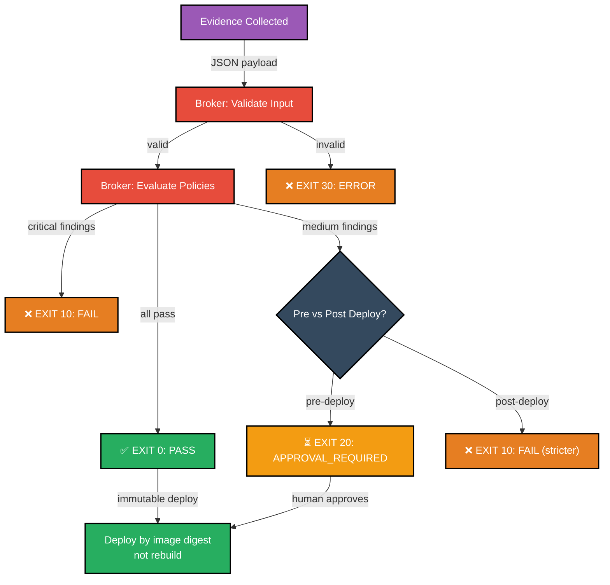

# Architecture: Release Governance Pipeline

This document describes the governance pipeline architecture and how the Broker controls release decisions.

## Overview

The POC demonstrates a release governance system where a Broker (policy engine) controls deployment by:
1. **Collecting evidence** from CI/CD pipelines and application state
2. **Evaluating policies** against that evidence
3. **Making deterministic decisions** (PASS, FAIL, APPROVAL_REQUIRED, ERROR)
4. **Enforcing approval gates** before deployment
5. **Verifying post-deployment state** and making stricter policy decisions

## Release Governance Flow

```mermaid
graph LR
    A["📦 Build & Test"] -->|collect evidence| B["📋 Evidence Package"]
    B -->|JSON payload| C["🔍 Broker Policy Engine"]
    C -->|decision| D{"Exit Code"}
    D -->|0: PASS| E["✅ Auto-Deploy"]
    D -->|10: FAIL| F["❌ Block Release"]
    D -->|20: APPROVAL_REQUIRED| G["⏳ Human Approval Gate"]
    G -->|approved| E
    G -->|rejected| F
    E -->|deployed| H["📊 Application Runtime"]
    H -->|collect runtime evidence| I["📋 Runtime Evidence"]
    I -->|JSON payload| C
    C -->|stricter policy| D
    
    style A fill:#4A90E2,stroke:#000,stroke-width:2px,color:#fff
    style B fill:#9B59B6,stroke:#000,stroke-width:2px,color:#fff
    style C fill:#E74C3C,stroke:#000,stroke-width:2px,color:#fff
    style E fill:#27AE60,stroke:#000,stroke-width:2px,color:#fff
    style F fill:#E67E22,stroke:#000,stroke-width:2px,color:#fff
    style G fill:#F39C12,stroke:#000,stroke-width:2px,color:#fff
    style H fill:#16A085,stroke:#000,stroke-width:2px,color:#fff
    style D fill:#34495E,stroke:#000,stroke-width:2px,color:#fff
    style I fill:#9B59B6,stroke:#000,stroke-width:2px,color:#fff
```



## Exit Codes & Policy Outcomes

The Broker returns deterministic exit codes that drive deployment decisions:

| Exit Code | Outcome | Action | Notes |
|-----------|---------|--------|-------|
| 0 | PASS | Deploy immediately | All policies satisfied |
| 10 | FAIL | Block release | Policy violation; no approval gate |
| 20 | APPROVAL_REQUIRED | Route to human gate | Medium/minor findings; approval can override |
| 30 | ERROR | Block release | Validation failure or provider error |

## Evidence Collection

Evidence is collected at two points in the pipeline:

### Pre-Deployment Evidence
Collected during CI/CD pipeline (build, test, publish stages):
- **Code diff**: Changes between base and current branch (relative paths only)
- **Dependencies**: Installed packages and versions
- **Test results**: Pass/fail counts, coverage metrics
- **Build logs**: Compilation output, build time
- **Container image**: Digest (SHA256), base images, layers

**Format**: JSON payload with relative paths only (no absolute paths, no `../` escapes)

### Post-Deployment Evidence
Collected after deployment to production:
- **Runtime configuration**: Environment variables, feature flags
- **System state**: Memory, CPU, disk usage
- **Application logs**: Errors, warnings, performance metrics
- **Service dependencies**: Connected services, versions
- **Security scan results**: Vulnerability assessments

**Format**: Same JSON structure as pre-deployment evidence

## Policy Decision Flow



## Immutable Deployment Principle

Once code is reviewed and approved, deployment uses the exact Docker image digest (SHA256 hash) that was reviewed—**never rebuilt**. This ensures:

- **What was reviewed is what runs** — no drift between CI and production
- **Reproducible deployments** — same digest always produces same behavior
- **Audit trail** — every deployment linked to exact code review and Broker decision
- **Policy enforcement** — Broker controls which digests can deploy

Example flow:
1. Build produces image digest `sha256:abc123def456...`
2. Image is published and evidence collected (includes digest)
3. Broker evaluates policy against evidence (digest included)
4. If approved, deployment pulls exact `sha256:abc123def456...` from registry
5. No rebuild, no recompilation—exact image that was reviewed runs in production

## System Components

### Runtime Tier
- **Application Pod**: Simple task tracker (minimal feature set)
- **Database**: SQLite (persistent volume)
- **Nginx**: Reverse proxy and static file serving

### Governance Tier
- **CI/CD Pipeline**: GitHub Actions (test → build → publish → evidence → Broker → approval → deploy)
- **Broker Engine**: Policy evaluation and decision making (can be mocked initially)
- **Evidence Collector**: Gathers build artifacts, test results, container metadata
- **Approval Gate**: Human review interface and decision routing
- **Post-Deploy Monitor**: Collects runtime evidence and triggers stricter policy review

### External Integrations
- **Docker Registry**: Stores and serves container images by digest
- **GitHub Actions**: Orchestrates CI/CD workflow, approval routing
- **Broker API**: Receives evidence, returns policy decisions (exit codes)

## Policy Evaluation (Simplified)

The Broker evaluates evidence against policies. Example policy logic:

```
IF test_results.failures > 0 THEN
  RETURN FAIL (exit 10)
END

IF dependencies.has_known_vulnerabilities THEN
  RETURN FAIL (exit 10)
END

IF code_diff.lines_changed > 5000 THEN
  RETURN APPROVAL_REQUIRED (exit 20)
END

IF all_checks_pass THEN
  RETURN PASS (exit 0)
END
```

Post-deployment policies are stricter (treat MEDIUM findings as FAIL instead of routing to approval).

## Deployment Workflow

### Pre-Deployment Gate (CI/CD)
```
1. Code pushed to branch
2. GitHub Actions triggered
3. Run tests → Build image → Publish to registry
4. Collect evidence (diff, dependencies, test results, image digest)
5. Invoke Broker with evidence
6. Broker returns exit code
   - EXIT 0 (PASS) → Deploy immediately
   - EXIT 10 (FAIL) → Stop, notify developers
   - EXIT 20 (APPROVAL_REQUIRED) → Create approval ticket, wait for human review
   - EXIT 30 (ERROR) → Stop, investigate error
7. If approved or PASS, deploy using image digest
```

### Post-Deployment Verification
```
1. Application deployed and running
2. Wait 5 minutes for stabilization
3. Collect runtime evidence (logs, metrics, health checks)
4. Invoke Broker with runtime evidence (uses stricter policy)
5. Broker returns exit code
   - EXIT 0 (PASS) → Release verified, mark as stable
   - EXIT 10 (FAIL) → Trigger rollback, create incident
   - EXIT 20/30 → Escalate (no approval gate in post-deploy)
```

## Key Design Decisions

1. **Evidence as JSON** — Structured, machine-readable, easy to version and audit
2. **Relative paths only** — Security: prevents path traversal attacks and accidental exposure of absolute paths
3. **Deterministic exit codes** — Clear, unambiguous decisions (no string parsing, no ambiguity)
4. **Two-policy model** — Pre-deploy: can route to approval; post-deploy: stricter, no approval
5. **Immutable deployments** — By digest, not by tag—ensures reviewed code actually runs
6. **Broker is stateless** — No side effects, only policy evaluation; evidence is the source of truth

## Integration Points

- **GitHub Actions**: Calls Broker API with evidence, receives exit code, routes to approval or deployment
- **Broker API**: Stateless service that evaluates policies and returns exit codes
- **Approval gate**: GitHub issue creation, PR comment, or custom interface (out of scope for this POC)
- **Docker Registry**: Stores images; deployments reference exact digest
- **Application logs**: Post-deploy monitoring collects evidence for stricter policy review

## Testing Strategy

- **Unit tests**: Policy evaluation logic, evidence validation
- **Integration tests**: Broker API mocking, full CI/CD flow with fake evidence
- **End-to-end tests**: Real app deployment, evidence collection, Broker integration (can mock Broker initially)

## Security Considerations

- **Evidence integrity**: Evidence collected in CI/CD (trusted) pipeline; cannot be forged in production
- **No hardcoded credentials**: All secrets in environment variables or GitHub Secrets
- **Policy as code**: Policies should be version-controlled and auditable
- **Audit trail**: Every decision logged with evidence payload, timestamp, decision, and rationale
- **Approval routing**: Clear escalation path for human review (GitHub issue or custom UI)
